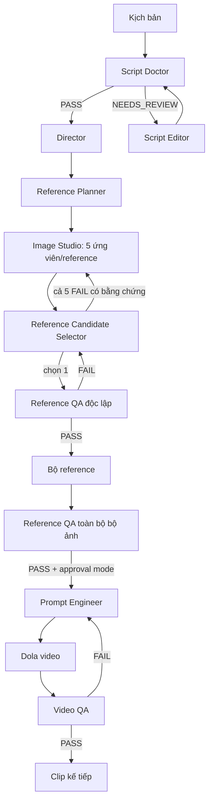

# Film Studio — kiến trúc chatbot và luồng tự động

Tài liệu này là mô tả chính thức về các chatbot trong Film Studio. Mã điều phối nằm ở `studio_workflow.py`, `studio_runtime.py` và `studio_chatgpt.py`; tài liệu này mô tả trách nhiệm và luồng dữ liệu của chúng, không thay thế trạng thái thực tế trong database.

## Nguyên tắc vận hành

Mỗi chatbot có một chat riêng trong Project Film Studio và chỉ xử lý nhiệm vụ có `task_id` được giao. Chatbot không tự gọi chatbot khác, không tự sửa queue, approval, phiên bản hoặc retry. **Workflow Orchestrator** là thành phần duy nhất chuyển kết quả từ chatbot này thành input bất biến cho chatbot kế tiếp.

Mỗi giao việc gồm `run_id`, `task_id`, vai trò, instruction, artifact đầu vào, schema đầu ra và các constraint đã khóa. Chatbot trả đúng một JSON object theo schema. Orchestrator validate kết quả trước khi lưu artifact và chuyển bước. Chat cũ là bối cảnh làm việc của vai trò, không phải nguồn sự thật về trạng thái dự án.



`NOT_INSPECTED`, `NEEDS_REVIEW`, media thiếu, upload thất bại, kết quả không parse được hoặc delivery chưa chắc chắn **không phải** là FAIL. Các trạng thái đó giữ artifact hiện tại và tạo retry/reconciliation có kiểm soát; chúng không được phép làm mất ảnh, tự sinh lại ảnh, hoặc tự coi là PASS.

## Danh sách chatbot

| Vai trò / chat | Nhiệm vụ | Input chính | Output/handoff |
|---|---|---|---|
| Showrunner | Quan sát toàn cục, nêu blocker và đề xuất. | Snapshot run và handoff đã hoàn tất. | Không tự chuyển trạng thái. |
| Script Analyst & Editor | Sửa bản screenplay khi Script Doctor nêu lỗi lớn. | Screenplay hiện hành và revision request. | Screenplay hoàn chỉnh mới. |
| Script Doctor | Đánh giá nhân quả, nhân vật, thoại, thời lượng và tính khả thi. | Toàn bộ screenplay. | PASS hoặc lỗi có bằng chứng để Editor sửa. |
| Production Architect & Director | Chia kịch bản thành clip 30 giây, contract, màu, dependency. | Screenplay đã qua cổng. | Production plan và clip contract. |
| Reference Planner | Lập manifest reference, character sheet, môi trường, đạo cụ và mapping clip. | Plan và screenplay đã khóa. | Reference plan. |
| Reference Creator | Chỉ mô tả/tạo reference theo specification. | Một reference spec và repair notes. | Image Studio job/image ID. |
| **Reference Candidate Selector** | Chọn ảnh mạnh nhất trong 5 ứng viên của một reference. Không phê duyệt cuối cùng. | 5 ảnh thực tế, specification, repair notes, reference nhận dạng nếu có. | Chỉ số 1–5, evidence hoặc FAIL sau khi đã xem cả 5. |
| **Reference QA** | Kiểm tra độc lập ảnh được Selector chọn; sau đó kiểm tra toàn bộ bộ reference. | Ảnh được chọn, spec, identity reference; hoặc bộ ảnh đã chọn. | PASS/FAIL/NOT_INSPECTED/NEEDS_REVIEW có evidence. |
| Prompt Engineer | Lập prompt tiếng Anh bám clip contract, màu và reference đã duyệt. | Clip contract, screenplay excerpt, skill snapshot, reference mapping. | Prompt Dola/Seedance và handoff clip. |
| Video QA | Kiểm tra video thật và audio Dola khi có thoại. | Video tải về, script excerpt, màu, reference/take liên quan. | PASS/FAIL/NOT_INSPECTED/NEEDS_REVIEW, evidence timestamp. |

## Luồng reference: năm ảnh, Selector, QA độc lập

1. Reference Creator yêu cầu Image Studio tạo **năm ứng viên độc lập** cho cùng một reference.
2. Chỉ khi năm file ảnh thực tế đã có, Orchestrator tạo task `reference_candidate_qa` cho **Reference Candidate Selector**.
3. Selector nhận skill snapshot `reference_selection`, năm ảnh theo thứ tự 1–5, specification, repair notes và ảnh nhân dạng liên quan. Selector chọn một ảnh có evidence, hoặc chỉ trả FAIL khi đã inspect cả năm và tất cả không đạt.
4. PASS của Selector không làm ảnh trở thành reference. Orchestrator tạo `reference_selected_qa` cho **Reference QA** với chỉ ảnh đã chọn và các chuẩn liên quan.
5. Reference QA PASS mới ghi ảnh vào `run.images` để dùng tiếp. Với character sheet, PASS cần đủ các kiểm tra góc toàn thân, góc mặt, nhận dạng/trang phục, chi tiết/đạo cụ áp dụng.
6. Reference QA FAIL tạo artifact `candidate_rejection`. Selector nhận lại feedback đó và phải chọn ứng viên chưa bị loại trong cùng lô năm ảnh.
7. Chỉ khi Selector có bằng chứng rằng cả năm ứng viên đã bị loại mới tạo lô năm ảnh thay thế. Lô cũ, feedback và version vẫn được giữ.
8. Khi tất cả reference đã có một ảnh qua kiểm tra độc lập, Reference QA thực hiện kiểm tra toàn bộ bộ ảnh trước approval của user hoặc agent mode.

## Skills

- `reference_selection` là skill cục bộ cho Reference Candidate Selector: [SKILL.md](skills/reference-selection/SKILL.md). Nội dung được snapshot vào task trước khi gửi để một thay đổi sau này không làm thay đổi tiêu chuẩn của task đang chạy.
- `emily2040`, `sjinn-ai` và `sd25-pe` chỉ được snapshot cho Prompt Engineer. Chúng không có quyền đổi screenplay, approval, màu đã khóa, quota hoặc điều khiển dịch vụ ngoài.
- Skill là instruction bổ sung, không phải kết quả QA. Không có media thực tế thì Selector/QA vẫn phải trả `NOT_INSPECTED` hoặc `NEEDS_REVIEW`.

## Cơ chế duy trì luồng

- `not_sent → sending → sent → received` là delivery thành công. Trước Send, worker journal task marker và chat URL; sau restart phải đối soát marker trước retry.
- `uncertain` cấm gửi lặp mù. Worker đối soát chat trước rồi mới quyết định recovery.
- `invalid_result` hoặc schema lỗi không chuyển workflow; response được giữ để chẩn đoán.
- Upload media có preflight: worker phải xác nhận attachment xuất hiện trong composer trước Send. Nếu không xác nhận được, task không được gửi như một task “có ảnh”.
- Khi một chat bị busy, một file thiếu, Dola lỗi hoặc quota hết, runtime retry theo trạng thái riêng; không biến lỗi transport thành lỗi chất lượng ảnh/video.
- Approval chỉ tồn tại ở hai cổng: screenplay/thay đổi nội dung và toàn bộ bộ reference. Agent mode chỉ thay người quyết định ở các cổng đó; nó không bỏ QA media.

## Gói giao tiếp

```json
{
  "protocol_version": 1,
  "message_type": "film_studio.task",
  "run_id": "film_...",
  "task_id": "agent_...",
  "recipient": "reference_selector",
  "role": "reference_selector",
  "inputs": [],
  "skills": {"reference_selection": {"hash": "...", "source": "..."}},
  "output_schema": {},
  "response_contract": {"task_id_must_equal": "agent_..."}
}
```

Kết quả luôn có dạng `{"task_id":"agent_...","output":{}}`. Artifact output được lưu bất biến cùng input parents và hash. Agent sau chỉ thấy artifact/version được Orchestrator cấp trong envelope mới.

## Trạng thái hiện tại cần biết

Reference Candidate Selector đã được thêm vào run hiện tại và ba task đang chờ (`THEATER_LAYOUT`, `HWEI_PRESENT`, `JHIN_THEATER`) đã được snapshot skill. Run đang tạm dừng vì ChatGPT web chưa xác nhận được ảnh đính kèm trong composer; không được resume chỉ để gửi metadata thay cho ảnh. Xem [CHATGPT-TRANSPORT.md](CHATGPT-TRANSPORT.md) để biết blocker vận hành hiện tại.
